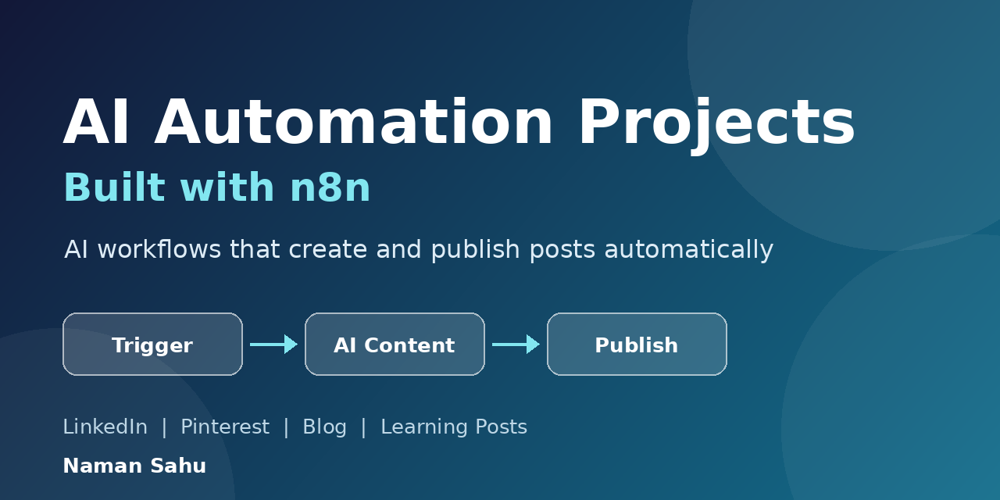

## About
n8n workflows that use AI to create and publish content automatically.

## Workflows
| Workflow | What it does | Files |
|---|---|---|
| Blog Auto-Poster | [what it does] | ai-blogger-auto-poster.json |
| LinkedIn Auto-Poster | [what it does] | linkedin-workflow.json, demo video |
| Pinterest Auto-Poster | [what it does] | pinterest folder |
| Learning Post Generator | [what it does] | [file name] |

## Tools used
n8n, [AI model you used], Gmail, Google Sheets, LinkedIn, Pinterest, [blog platform]

## How to use
Import any workflow JSON file into n8n and add your own credentials.

## Screenshots
See the `screenshots`, `linkedin` and `pinterest` folders.

## Author
Naman Sahu | [LinkedIn](https://linkedin.com/in/namansahu002) | [Portfolio](https://naman-sahu.netlify.app)
